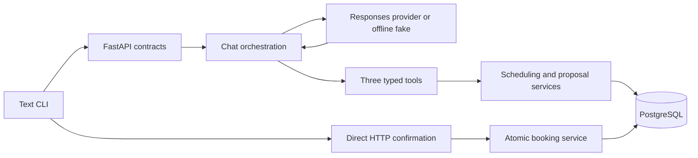

# Clinic Scheduling Agent — system architecture

Synthetic, text-based local prototype. The original voice architecture is superseded. No application business rules or M4 agent boundaries changed in M6.

| Component | Responsibility |
| --- | --- |
| `cli/` | Private client session/idempotency state, HTTP calls, verified display. Explicit confirm never enters chat. |
| `app/api/`, `app/schemas/` | Versioned contracts, bearer-derived ownership, validated inputs and safe error/trace envelopes. |
| `app/domain/`, `app/services/scheduling.py` | Deterministic temporal/interval rules and PostgreSQL-backed availability. |
| `app/services/booking.py` | Immutable proposals, one-way terminal states, exact confirmation, exclusion conflict mapping and durable outcomes. |
| `app/services/chat.py`, `conversation.py` | Durable turn journal, client-message deduplication, short lease/fence transactions and restart continuation. |
| `app/agent/` | Strict registry, Responses wire adapter/context and typed model plan with deterministic fact rendering. |
| `app/db/`, `alembic/` | Ten-table schema, structural ownership/uniqueness/exclusion constraints and synthetic catalog. |
| `evaluations/` | Independent bounded oracle and separate raw/backend/visible graders over scripted and live decisions; explicit contracts 1.0/1.1. |
| `scripts/demo_*` | Guarded test-only setup and fixture cleanup; controlled real concurrency, no global reset. |

Availability and proposals do not reserve a slot. Confirmation revalidates policy, inserts under a PostgreSQL exclusion constraint and atomically commits appointment, proposal state and idempotency outcome. No generated text authorizes this operation.

A chat request claims a short expiring lease/fence, releases its DB transaction before provider I/O, then fences every write/effect. Proposal creation and its correlated journal output share an outer transaction around the unchanged M3 service's Session savepoints. Required reasoning and call/output context remains whole; oldest complete turns are dropped to fit the bound.

Historical chat results and current proposal state are separate: replay preserves turn/message/trace and refreshes its proposal projection. M3 confirmation replay retains exact original status/body. These accepted distinctions and typed rendering are reviewed in [M5 findings](docs/M5_RECONCILIATION.md).

See [ADR-001 through ADR-008](docs/ADR_INDEX.md), [data model](docs/DATA_MODEL.md), [API design](docs/API_DESIGN.md) and [security limits](docs/SECURITY_PRIVACY.md). Public release remains blocked; this design is not a production architecture claim.

## Contract evolution and evidence

The proposal tool uses a dedicated strict five-character HH:MM input string with a 24-hour pattern, then converts through the existing ProposalRequest validator. It never advertises broader format:time, normalizes malformed time, or relaxes scheduling policy. Only clarify ReplyPlans may contain missing_fields; other kinds require an empty list. Invalid combinations fail safely through the existing 503 path, with raw output retained privately for independent evaluation.

Availability rendering adds interval-selection/proposal guidance while preserving the non-reservation and separate-confirmation boundaries. Grader 1.1 checks the exact new grammar and every interval against independent evidence; 1.0 remains frozen. See [contracts](docs/EVALUATION_CONTRACTS.md) and [observed live results](docs/LIVE_EVALUATION_REPORT.md). Hosted CI validated the root commit, not these later uncommitted changes.
